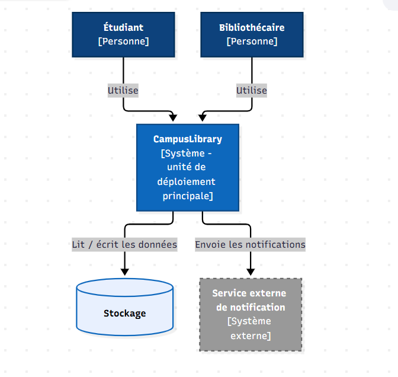
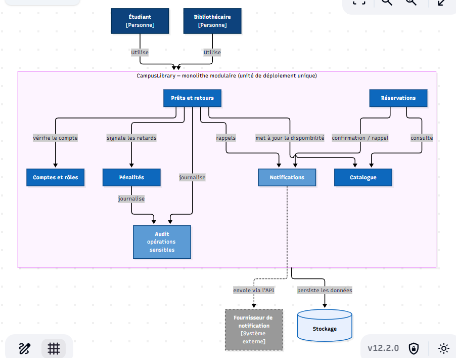
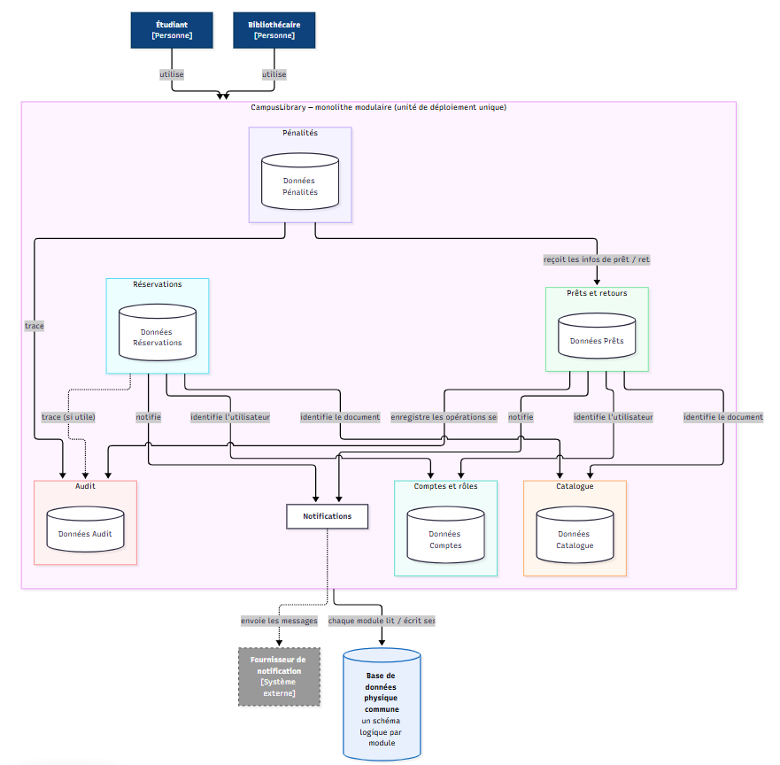

# Monolithic and Modular Monolith Architectures: CampusLibrary

A conceptual project on **monolithic** and **modular monolith** architectures. No code is involved: the work is about understanding concepts, analyzing architectures, reading diagrams, and designing diagrams.

## Goals

By the end of the project, you should be able to:

- Define a monolith and a modular monolith, and explain what a deployment unit is
- Identify the advantages, limits, and suitable contexts of a monolith
- Distinguish a module from a microservice, and modularity from deployment
- Explain cohesion, coupling, internal dependencies, and circular dependencies
- Understand logical data ownership on top of a shared physical database
- Tell a visible fact from an assumption when reading a diagram
- Design a monolith diagram and a modular monolith diagram, and evolve it with new constraints

## Key concepts

| Concept | Summary |
|---|---|
| **Monolith** | One main application deployed as a single unit. It can still contain many features, layers, modules, user types, and external integrations. |
| **Modular monolith** | A monolith that stays one deployment unit but is organized into business modules with explicit internal boundaries. |
| **Module** | A cohesive group of responsibilities, named after the business (e.g. `Accounts`, `Catalog`), not after technical roles (`Utils`, `Helpers`). |
| **Cohesion** | How closely related the responsibilities inside a module are. High cohesion is preferred. |
| **Coupling** | The level of dependency between modules. Dependencies should be necessary, explicit, and limited. |
| **Circular dependency** | A dependency chain that loops back to its start (A → B → C → A). It makes the system harder to understand and change. |
| **Logical data ownership** | Each module owns its data, even when all modules share one physical database. |

**Monolith vs modular monolith**

| | Monolith | Modular monolith |
|---|---|---|
| Deployment | Single unit | Single unit |
| Internal organization | Variable | Explicit business modules |
| Dependencies | Not necessarily visible | Visible and controlled |
| Data | Not necessarily structured | Logical ownership per module |
| Scaling | Usually global | Usually global |

**Possible advantages of a monolith:** simple deployment, simple internal communication, easy operations for small teams, limited initial infrastructure.

**Possible limits:** global deployment and scaling, growing internal complexity, many dependencies, team coordination, wide impact of failures.

> There is no universal best architecture. The right choice depends on needs, constraints, responsibilities, dependencies, and trade-offs.

## Practical case: CampusLibrary

A university wants to build **CampusLibrary**, a library management application, delivered as one main deployment unit.

**Students** can browse the catalog, check document availability, reserve a document, view their loans, and renew a loan when allowed.

**Librarians** can add and edit documents, record loans and returns, view reservations, and manage some penalties.

**The application handles:** accounts, roles, catalog, loans, returns, reservations, penalties, notifications, and traceability of sensitive operations.

**Constraints:** one main deployment unit; no imposed technology, language, or framework; no class diagram and no code; clear responsibilities; visible key dependencies; external systems clearly distinguished.

## Deliverables

Three diagrams, stored in the [`diagrammes/`](diagrammes) directory:

| # | File | Description |
|---|---|---|
| 1 | `diagramme_1_monolith.jpg` | Global view of CampusLibrary with no internal structure. Shows Student, Librarian, CampusLibrary, Storage, and the external notification service. |
| 2 | `diagramme_2_modulaire_simple.jpg` | Modular view. Shows the CampusLibrary boundary, the business modules inside it (accounts and roles, catalog, loans and returns, reservations, penalties, notifications, audit), actors and notification provider outside, and a common deployment unit. |
| 3 | `diagramme_3_modulaire_avance.jpg` | Adds the main dependencies between modules and the logical data ownership (Accounts, Catalog, Loans, Reservations, Penalties, and Audit data) on a shared physical database. |

### Previews





## Repository structure

```text
holbertonschool-architectures_monoliths_modulaires/
├── README.md
└── diagrammes/
    ├── diagramme_1_monolith.jpg
    ├── diagramme_2_modulaire_simple.jpg
    └── diagramme_3_modulaire_avance.jpg
```

## Tips for the diagrams

- Start with the actors, then the system, then its responsibilities
- Group closely related responsibilities and use business names
- Draw only useful dependencies, with clear arrow directions
- Distinguish modules, data, and external systems
- Do not assume modules are independent services, or that a shared database prevents modularity
- Do not add technologies that were not requested

## Resources

- [Microsoft Learn: Common web application architectures](https://learn.microsoft.com/fr-fr/dotnet/architecture/modern-web-apps-azure/common-web-application-architectures) (FR)
- [Martin Fowler: Monolith First](https://martinfowler.com/bliki/MonolithFirst.html) (EN)
- [C4 Model: Diagrams](https://c4model.com/diagrams) (EN)
- Microsoft Learn: Modular monoliths (FR)
